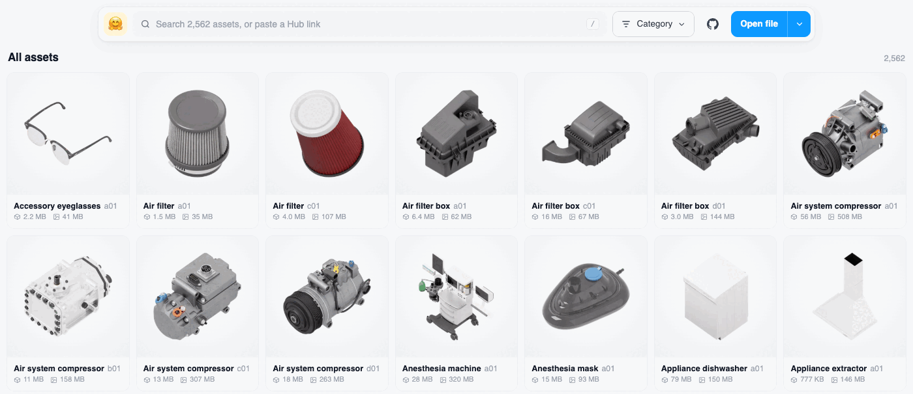

<p align="center">
  
</p>

<h1 align="center">USD Web Viewer now lives in huggingface.js</h1>

<p align="center">
  <a href="https://www.npmjs.com/package/@huggingface/usd-web-viewer"></a>
  <a href="https://github.com/huggingface/huggingface.js/blob/main/packages/usd-web-viewer/LICENSE"></a>
  <a href="https://huggingface.co/spaces/cfahlgren1/usd-viewer"></a>
</p>

> [!IMPORTANT]
> The library is now [`@huggingface/usd-web-viewer`](https://www.npmjs.com/package/@huggingface/usd-web-viewer), developed in [huggingface/huggingface.js](https://github.com/huggingface/huggingface.js/tree/main/packages/usd-web-viewer). This repository is archived and read-only.

[OpenUSD](https://openusd.org) in the browser: a pure-Rust USD core ([openusd](https://github.com/mxpv/openusd)) compiled to WebAssembly and rendered with [three.js](https://threejs.org). It reads `.usd`, `.usda`, `.usdc` and `.usdz`.

```sh
npm install @huggingface/usd-web-viewer three
```

```js
import { createViewer } from '@huggingface/usd-web-viewer';

const viewer = createViewer(document.getElementById('viewer'));
await viewer.load('https://huggingface.co/datasets/Robotiq-Official/simready-assets/resolve/main/Robotiq_2F_85/simready_usd/Robotiq_2F_85.usda');
```

<a href="https://huggingface.co/spaces/cfahlgren1/usd-viewer"></a>

## Links

- **Source:** [packages/usd-web-viewer](https://github.com/huggingface/huggingface.js/tree/main/packages/usd-web-viewer) in huggingface.js
- **npm:** [@huggingface/usd-web-viewer](https://www.npmjs.com/package/@huggingface/usd-web-viewer)
- **Docs:** [huggingface.co/docs/huggingface.js/usd-web-viewer/README](https://huggingface.co/docs/huggingface.js/usd-web-viewer/README)
- **Live demo:** [cfahlgren1/usd-viewer](https://huggingface.co/spaces/cfahlgren1/usd-viewer), a gallery of 2,562 NVIDIA SimReady assets
- **Issues and pull requests:** [huggingface/huggingface.js](https://github.com/huggingface/huggingface.js/issues)

The code and history up to the move stay here for reference.
